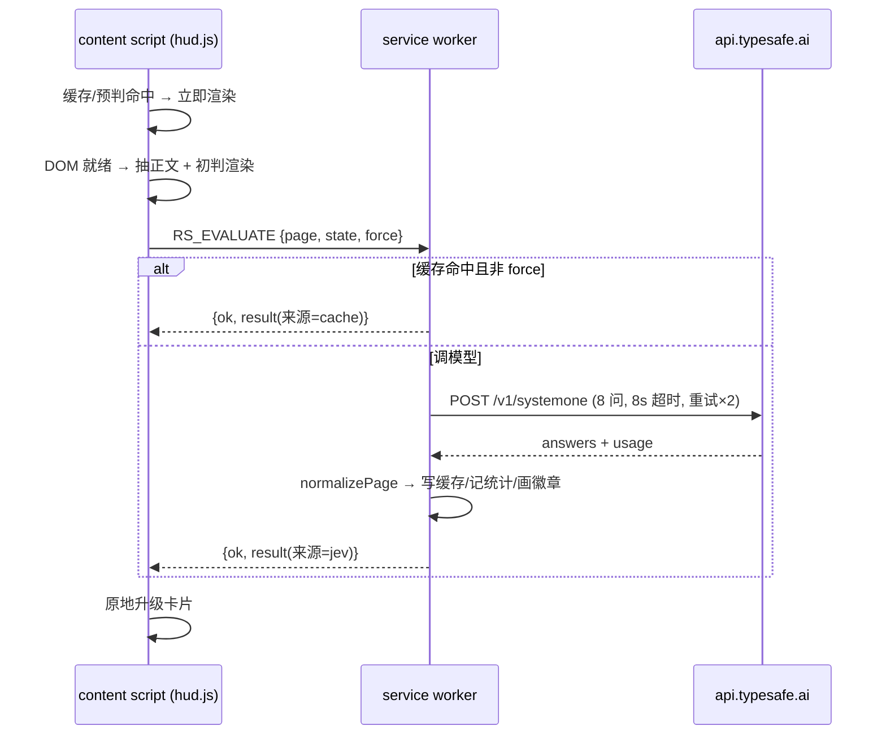

# 功能账簿（Feature Ledger）

事实源：以 `src/` 实际源码、`manifest.json`、`tests/` 与可复现的运行结果为准，不以 README 或历史记忆为准。
最近核对：2026-10-23（`npm test` 263/263 全绿，24.4s；本文件随每轮改动同步）。

验证状态口径：

- **已验证（自动）**：`tests/` 中有用例覆盖，且本轮 `npm test` 通过。测试环境是 jsdom + chrome API 模拟，不是真实浏览器。
- **已验证（手动）**：真实浏览器中人工验证过（记于提交记录，如「QA 第五轮固化契约」）。本轮未复验的一律标注日期缺失。
- **待核实**：证据不足，不能确认真实浏览器中的行为。
- **部分实现**：只覆盖部分场景。

> 提醒：构建成功 ≠ 浏览器里正常运行；jsdom 全绿 ≠ 真实 Chrome 全绿。涉及引擎 DOM 选择器、样式隔离、后台生命周期的功能，真实浏览器验证记录见各条目的「验证状态」。

## 总览

| ID | 功能 | 触发入口 | 状态 | 验证状态 |
| --- | --- | --- | --- | --- |
| F-001 | 页面判定浮层（HUD） | 自动（页面加载） | 已实现 | 自动 + 历史手动 |
| F-002 | 本地启发式初判 | 自动（HUD 内部） | 已实现 | 自动 |
| F-003 | 正文抽取 | 自动（HUD 内部） | 已实现 | 自动 |
| F-004 | 模型评估（Jev 8 问） | 自动 / 重新评估 | 已实现 | 自动（mock）；真实 API 待核实 |
| F-005 | 搜索结果标注 | 自动（6 引擎结果页） | 已实现 | 自动 + 历史手动；各引擎选择器待核实 |
| F-006 | 结果缓存（LRU/TTL） | 自动 | 已实现 | 自动 |
| F-007 | 用量统计 | 自动记录 | 已实现 | 自动 |
| F-008 | 工具栏徽章 | 自动 | 已实现 | 自动 |
| F-009 | 快捷键 Alt+Shift+R | 键盘 | 已实现 | 自动（消息层）；按键手感待核实 |
| F-010 | 弹窗（Popup） | 工具栏点击 | 已实现 | 自动 |
| F-011 | 设置页（Options） | 弹窗 → 设置 | 已实现 | 自动 |
| F-012 | 站点黑名单与分站点暂停 | HUD 菜单 / 弹窗 / 设置 | 已实现 | 自动 |
| F-013 | 隐私模式（仅标题摘要） | 设置 | 已实现 | 自动（buildState）；后台兜底路径见已知问题 |
| F-014 | 错误处理与退避重试 | 自动 | 已实现 | 自动（mock） |
| F-015 | 消息协议与后台路由 | 内部 | 已实现 | 自动 |
| F-016 | 主题 / 可访问性 / 样式隔离 | 自动 | 已实现 | 自动（含 WCAG 复算、审计契约） |
| F-017 | 搜索结果宿主样式审计 | 自动（徽章挂载后） | 已实现 | 自动（契约）；真实页面取证待核实 |

---

## F-001 页面判定浮层（HUD）

- **用户价值**：打开网页立刻知道「值得认真读 / 快速扫 / 可以跳过」，不用读完才知道浪费时间。
- **触发入口**：http/https 页面加载自动挂载（`document_start` 注入，DOM 就绪后渲染）；`Alt+Shift+R` 显隐；`Esc` 收起（仅焦点/指针在浮层上时）。
- **预期行为**：命中缓存/预判 → <20ms 出结论；否则先出「本地估算」（标注来源），DOM 就绪后抽取正文，发后台评估，模型返回后原地升级（不闪烁不跳位）。默认 9s 自动收成角标；角标可拖动（位置持久化 `rs.hud.pos`）；卡片含重新评估、暂停▾、关闭。不弹的每种原因记在 `S.skipped`（off / blocked / serp / not-readable / error），弹窗可解释。启动或抽取抛错时不安静：状态里记 `S.error`，页面留一张只写原因的「出错」卡片（不借用空页面的假分数）。
- **实现位置**：`src/content/hud.js`（mount/render/expand/evaluate/fail/onNavigate/onKey）；依赖 `RS.extract`、`RS.heuristics`、`RS.storage`、`RS.MSG.EVALUATE`。
- **运行环境**：content script（仅 top frame，`window.__RS_HUD_LOADED__` 防重）。渲染在 Shadow DOM（`all: initial` 起手）。
- **API 与权限**：`chrome.runtime.sendMessage`（EVALUATE / OPEN_OPTIONS）、`chrome.runtime.onMessage`（RS_TOGGLE_PANEL / RS_FORCE_REFRESH / RS_GET_HUD_STATE）、`chrome.storage.local`（设置、缓存、位置）。无新增权限。
- **配置与数据**：`showHud`、`hudAutoCollapseMs`、`hudPosition`（预留未消费）、`enabled`；`rs.hud.pos = {left, top}`。
- **当前状态**：已实现。
- **验证状态**：已验证（自动）：`08-hud`（挂载条件、两阶段升级、收起、错误提示）、`17-boot-failure`（抽取抛错→卡片带原因、读设置抛错→不挂浮层但状态留痕、缓存已挂但正文抽不出来→重评不给分数）、`18-footmeta`（耗时恰为 0ms 仍显示）、`11-ui-regression`（令牌、命中区、自动收起保留焦点）。已验证（手动）：历史 QA 轮次（提交 `aa3f8c7`/`57d4f86` 等），本轮未复验。
- **已知问题**：① ~~`init().catch(() => {})` 吞掉一切初始化异常~~ **已修（2026-11-11）**：`fail()` 统一出口，记 `S.error` + 控制台日志 + 页面卡片；② SPA 导航检测用 1.2s 轮询 `location.href`（非事件驱动，轻量但常驻）；③ 导航后 `evaluate(true)` 强制绕缓存，与「force=重新评估」语义冲突，多花调用（本轮已改，见 CHANGELOG_DEV）。
- **关联关系**：F-002（初判）、F-003（正文）、F-004（评估）、F-006（缓存）、F-012（屏蔽/暂停）、F-015（消息）。

## F-002 本地启发式初判

- **用户价值**：模型返回前 0~80ms 就有可看的粗判，界面不空转。
- **触发入口**：HUD 内部（DOM 就绪、未命中缓存时）。
- **预期行为**：`scorePage(page, settings)` 输出与模型结果同构的对象（`source: "heuristic"`、`approximate: true`），UI 明示「初判」。硬排除：登录/导航/错误页、列表归档页、短首页、正文 <200 字。综合分 = 相关度 0.45 + 新信息 0.3 + 可信度 0.25。
- **实现位置**：`src/lib/heuristics.js`（`scorePage`、`topicOverlap`、`pathSignals`、`trustOfDomain`、`isBlocked`、`pauseStateOf`、`isSearchResultsPage`、`readingMinutes`）。
- **运行环境**：content script（hud.js 链）；popup 复用 `formatBytes`/`pauseStateOf`。
- **API 与权限**：无浏览器 API，纯计算。
- **配置与数据**：`topics`、`minTextLength`、`siteBlocklist`、`pausedSites`；`RS.TRUST_HIGH`/`RS.TRUST_LOW` 名单（constants.js）。
- **当前状态**：已实现。
- **验证状态**：已验证（自动）：`02-heuristics` 全套（分层、路径信号、主题重合、各判定分支）。
- **已知问题**：`trustOfDomain` 用子串 `includes` 匹配名单，仿冒域名（如 `developer.chrome.com.evil.io`）会蹭到 88 高可信（仅影响初判，模型结果覆盖；本轮已收紧为后缀边界匹配）。
- **关联关系**：F-001（消费方）、F-004（被模型覆盖）、F-012（isBlocked 是唯一屏蔽判定点）。

## F-003 正文抽取

- **用户价值**：快速拿到「够用」的正文与结构统计，供初判与模型评估使用，不污染宿主页。
- **触发入口**：HUD 内部（DOM 就绪后让两帧再抽，避开骨架屏）。
- **预期行为**：`RS.extract.page()` 用候选选择器（article/main/`.markdown-body`/微信 `#js_content` 等）打分选主节点，剥离 script/nav/form 等噪音，输出 text/charCount/paragraphCount/headings/codeBlocks/linkDensity 等。`buildState(page, settings)` 构造发给 Jev 的 state：full 模式带正文摘录（`excerptChars` 截断 + `truncated` 标记），titles 模式只带标题与摘要。
- **实现位置**：`src/lib/extract.js`（`page`、`buildState`、`cleanText`、`pickMainNode`）。
- **运行环境**：content script（`page()` 依赖 document；`buildState` 纯数据，后台亦可复用）。
- **API 与权限**：DOM 读取；无存储、无网络。
- **配置与数据**：`privacyMode`、`excerptChars`、`minTextLength`。
- **当前状态**：已实现。
- **验证状态**：已验证（自动）：`06-extract`（去噪、主节点、链接密度、隐私模式、截断）。
- **已知问题**：非完整 Readability——嵌套多主题页/懒加载正文可能抽偏；跨域 iframe、登录后正文拿不到（README 已声明）。
- **关联关系**：F-013（隐私模式在此落实）、F-004（state 输入）、F-002（page 统计输入）。

## F-004 模型评估（Jev 8 问）

- **用户价值**：给出可信的结构化判定（判定 + 4 维百分比 + 理由依据），单页约 ¥0.0005。
- **触发入口**：自动（HUD）；「重新评估」；设置页「测试连接」。
- **预期行为**：一次 `POST api.typesafe.ai/v1/systemone` 并发 8 问（4 score / 3 choice / 1 noul），`normalizePage` 归一化成 verdict + relevance/novelty/credibility/timelessness + value/contentType/redundancy/confidence + 本地拼装 reason。错误分类：NO_KEY/HTTP_401/403/422/429/529/TIMEOUT/NETWORK/BAD_SHAPE；可重试错误指数退避（400ms、1200ms）重试 2 次。
- **实现位置**：`src/lib/jev.js`（`systemOne`、解析辅助）、`src/lib/questions.js`（`pageQuestions`/`serpQuestions`/`normalizePage`/`normalizeSerp`/`composeReason`）；调用方 `src/background/service-worker.js`。
- **运行环境**：service worker（唯一持 Key、唯一跨域请求方——绕过页面 CORS）。
- **API 与权限**：`fetch`（host_permissions 限 `https://api.typesafe.ai/*`）。
- **配置与数据**：`apiKey`、`model`、`timeoutMs`（默认 8s）、`topics`。问题 instructions 英文、criteria 中文（直接作 UI 图例）。
- **当前状态**：已实现。
- **验证状态**：已验证（自动）：`03-jev`（三种原语解析、请求构造、错误分类与重试）、`04-questions`（问题结构、映射、理由分支）。**待核实**：真实 API 行为（`npm run test:api` 需真实 Key，本轮未执行）。
- **已知问题**：重试预算 3×8s + 退避 ≈ 25.6s，逼近官方「fetch 响应 30s 终结 SW」红线但未越线（见 TECHNICAL_REFERENCES R1）；`state` 直接信任调用方拼装，无 schema 校验。
- **关联关系**：F-005（SERP 4 问版）、F-006（写缓存）、F-007（记统计）、F-014（错误呈现）。

## F-005 搜索结果标注（SERP）

- **用户价值**：搜索时直接看每条结果的等级与可信度，少点开垃圾页。
- **触发入口**：6 引擎结果页自动（Google/HK/TW、Bing/中国版、百度、搜狗、DuckDuckGo、Brave）；`annotateSerp` 关闭时 HUD 顶上（不出现两边都空）。
- **预期行为**：识别引擎 → 等待结果节点 → 每条自然结果标题内插 Shadow DOM 徽章（等级 + 可信度%，悬停详情；非颜色线索：实心点/空心点/短横）→ 跳过引擎站内链接 → 顶部汇总条（读/扫/跳过计数）→ `EVALUATE_SERP` 批量评估（后台并发 5）→ 原地填结果。结果按 URL 写缓存（partial），点进结果页时 HUD 秒出预判。
- **实现位置**：`src/lib/engines.js`（**搜索引擎的单一事实源**：引擎 id / 主机 / 路径 / 查询词参数 / DOM 选择器 / match pattern）；`src/content/serp.js`（scan/placeChip/paintChip/renderSummary/observe）；后台 `handleSerp`。
- **运行环境**：content script（top frame）；徽章在各自 shadow root，汇总条在 light DOM（`#rs-serp-style` 一次注入）。
- **API 与权限**：`chrome.runtime.sendMessage`（EVALUATE_SERP）；`MutationObserver`（结果容器，400ms 防抖）。
- **配置与数据**：`annotateSerp`、`serpMaxResults`（默认 8）。
- **当前状态**：已实现。
- **验证状态**：已验证（自动）：`07-serp`（识别、插入位置、shadow 隔离、汇总、失败降级、审计契约、RTL）、`11-ui-regression`（WCAG 对比度复算、防御 CSS 契约）、`15-engines`（单一事实源一致性、防空窗/防双标注回归、Chrome match pattern 语义）。**已验证（真实浏览器，2026-11-04）**：Playwright + 本地夹具页 + `--host-resolver-rules` 实测徽章注入。**待核实**：各引擎真实 DOM（选择器随引擎改版失效是常态）。
- **已知问题**：① 查询词只从 `?q=` 提取——百度（`wd`/`word`）、搜狗（`query`）拿不到查询词，SERP 判定缺主信号（本轮已修，按引擎配置化）；② 引擎选择器硬编码在代码里，改版需发版（uBlacklist 的 SERPINFO 外置数据方案可参考，见 R2）；③ `collectNodes` 命中 ≥3 条即停，后续选择器的补充结果可能漏；④ **2026-11-04 已修**：百度的旧摘要选择器在真实页面上四条全 0（摘要始终为空），改用 `[class*='summary-text']` 前缀匹配，旧选择器保留作兜底（详见 CHANGELOG_DEV 第八轮）；⑤ **2026-11-04 横向排查**：必应（10/10 取到摘要）与搜狗（9/11）正常，Google/DDG/Brave 因网络超时未采到样本。
- **关联关系**：F-004（serpQuestions）、F-006（partial 缓存）、F-016/017（样式隔离与审计）、F-001（HUD 让位规则）。

## F-006 结果缓存（LRU / TTL）

- **用户价值**：点过的页秒出结论、翻回上一页不重复花钱。
- **触发入口**：自动（评估完成写入；评估前查询）。
- **预期行为**：`rs.cache = { urlKey: {at, title, partial, result} }`。urlKey 去 hash 与跟踪参数（utm_/ref/spm/from/share/fbclid/gclid/_hs）。完整结果 TTL `cacheTtlMs`（7d），预判 TTL `partialCacheTtlMs`（1d）。LRU 超 `cacheLimit`（300）按 at 淘汰最旧。预判不覆盖完整评估。写入经 Promise 链串行化（并发 5 路不互相覆盖）。`force: true` 绕过读缓存。
- **实现位置**：`src/lib/storage.js`（`getCacheEntry`/`putCacheEntry`/`trimCache`/`clearCache`/`urlKey`/`withCacheWriteLock`）。
- **运行环境**：service worker / content script / 扩展页共用。
- **API 与权限**：`chrome.storage.local`。
- **配置与数据**：`cacheTtlMs`、`partialCacheTtlMs`、`cacheLimit`。
- **当前状态**：已实现。
- **验证状态**：已验证（自动）：`05-storage`（URL 归一化、TTL、LRU、预判保护、并发写入）。
- **已知问题**：写锁是 SW 内存态 Promise 链，SW 重启瞬间的跨实例竞态无保护（窗口极窄，chrome.storage.set 单次原子，风险低）；缓存体积用 `JSON.stringify` 全量测量（300 条量级无碍）。
- **关联关系**：F-004/F-005（写入方）、F-001（消费方）、F-015（REQUEST_STATE 供弹窗/预判查询）。

## F-007 用量统计

- **用户价值**：知道花了多少（页数、调用、token、估算费用），建立成本感知。
- **触发入口**：自动（每次真实模型调用后）；弹窗与设置页展示。
- **预期行为**：`rs.stats = {calls, inputTokens, outputTokens, pages, verdicts{read,skim,skip}, lastAt}`。命中缓存不计调用（SERP 预判命中亦不计）。verdict 只接受已知枚举值。
- **实现位置**：`src/lib/storage.js`（`bumpStats`/`getStats`）；展示 `src/popup/popup.js`、`src/options/options.js`。
- **运行环境**：service worker 写；扩展页读。
- **API 与权限**：`chrome.storage.local`。
- **配置与数据**：`rs.stats`；费用按 $0.042/1M 输入 token × 7.1 汇率折算（options.js 硬编码）。
- **当前状态**：已实现。
- **验证状态**：已验证（自动）：`05-storage`（累加、非法 verdict 不计入）、`09-service-worker`（缓存命中不计数）。
- **已知问题**：`bumpStats` 读-改-写无串行化，并发评估（SERP 批量 + 页面）可能丢增量（同类 bug 已在缓存层修过；本轮已修）。
- **关联关系**：F-004/F-005（写入方）、F-010/F-011（展示）。

## F-008 工具栏徽章

- **用户价值**：不打开页面也能看到当前页判定（读/扫/跳）。
- **触发入口**：自动（评估成功后按 tab 绘制）。
- **预期行为**：徽章字「读/扫/跳」，底色为判定色，title 为完整判定词；安装/启动清空。
- **实现位置**：`src/background/service-worker.js`（`paintBadge`）。
- **运行环境**：service worker。
- **API 与权限**：`chrome.action.setBadgeText/setBadgeBackgroundColor/setTitle`（activeTab 即可）。
- **配置与数据**：无持久化（按 tab，随会话消失）。
- **当前状态**：已实现。
- **验证状态**：已验证（自动）：`09-service-worker`（tabId、文案、颜色、title、tab 已关不抛错）。
- **已知问题**：仅 EVALUATE 路径绘制；SERP 批量评估不画徽章（结果页本身有汇总条，属设计取舍）。
- **关联关系**：F-004、F-015。

## F-009 快捷键（Alt+Shift+R）

- **用户价值**：不碰鼠标显隐浮层。
- **触发入口**：`toggle-panel` 命令（manifest `commands` 建议键 Alt+Shift+R，用户可在 chrome://extensions/shortcuts 改）。
- **预期行为**：SW 收到命令 → 向活动 tab 发 `RS_TOGGLE_PANEL` → HUD 展开/收起（未挂载则 boot）。页面无内容脚本（chrome:// 等）时静默忽略。页面自身不抢按键（Esc 有条件响应）。
- **实现位置**：`src/background/service-worker.js`（`chrome.commands.onCommand`）、`src/content/hud.js`（toggle）。
- **运行环境**：service worker + content script。
- **API 与权限**：`chrome.commands`、`chrome.tabs.query/sendMessage`（activeTab）。
- **配置与数据**：无。
- **当前状态**：已实现。
- **验证状态**：已验证（自动）：`09-service-worker`（命令转发、无脚本页面容错）。**待核实**：真实浏览器按键冲突（与其他扩展抢同一组合键时 Chrome 后装者失效）。
- **已知问题**：无。
- **关联关系**：F-001。

## F-010 弹窗（Popup）

- **用户价值**：一眼看当前页结论与「为什么没弹」，并能立即补救（重评/解封/恢复/关浮层）。
- **触发入口**：工具栏图标点击。
- **预期行为**：读设置 → 显示 HUD/搜索标注开关 → 查当前 tab 的 `RS_GET_HUD_STATE` → 有结果渲染判定卡（指标/警告/芯片/元信息）；无结果按 skipped 原因给两句式解释 + 可执行动作（含 `error`：浮层启动失败时显示具体原因 + 刷新重试）；黑名单站点给「解除屏蔽」；暂停站点给「恢复评估」；「重新评估」发 `RS_FORCE_REFRESH` 后关窗。底部统计行（已评估页数、建议跳过、缓存条数）。
- **实现位置**：`src/popup/popup.js` + `popup.html` + `popup.css`。
- **运行环境**：扩展页（popup）。
- **API 与权限**：`chrome.tabs.query/sendMessage`（activeTab）、`chrome.runtime.openOptionsPage`、`chrome.storage.local`。
- **配置与数据**：读写 `showHud`、`annotateSerp`、`siteBlocklist`、`pausedSites`。
- **当前状态**：已实现。
- **验证状态**：已验证（自动）：`10-pages`（表单/保存/夹紧）、`12-popup-blocklist`（解除屏蔽 5 例）、`08-hud` 相关消息契约。
- **已知问题**：`composite()` 与 hud.js 重复实现（两处权重一致但双份维护）；`tab.url` 依赖 activeTab 授权时机（工具栏点击即授予，路径已测）。
- **关联关系**：F-001/F-012/F-015。

## F-011 设置页（Options）

- **用户价值**：Key、主题、隐私、缓存、黑名单全部可控可测。
- **触发入口**：弹窗齿轮 / HUD 错误提示「前往设置」/ `chrome.runtime.openOptionsPage`。
- **预期行为**：表单化配置（12 主题标签、夹紧数值、黑名单多行编辑）；保存（Ctrl+S）、恢复默认、清空缓存；「测试连接」发一次最小 noul 问题并打印往返延迟与 token；统计网格（页数/调用/跳过/token/估算花费/缓存条目与体积/判定分布）。
- **实现位置**：`src/options/options.js` + `options.html` + `options.css`。
- **运行环境**：扩展页（tab）。
- **API 与权限**：`chrome.storage.local`、`fetch`（测试连接走 SW？不——options 页扩展上下文直接 fetch，host_permissions 覆盖）。
- **配置与数据**：全部设置项；数值边界（excerptChars 500–30000 等）在 collect() 夹紧。
- **当前状态**：已实现。
- **验证状态**：已验证（自动）：`10-pages`（表单、主题标签、保存夹紧、连接自测 mock）。
- **已知问题**：「恢复默认」用 `saveSettings(DEFAULT_SETTINGS)` 合并写，未来新增键若有旧值会残留（迁移策略见 IMPROVEMENTS P3）；费用汇率/单价硬编码。
- **关联关系**：F-004（测试连接）、F-006/F-007（缓存与统计）。

## F-012 站点黑名单与分站点暂停

- **用户价值**：邮箱/网盘/登录页/社交流不被打扰；误屏蔽可退。
- **触发入口**：默认名单（constants）+ HUD「暂停▾」（1 小时/今天结束/7 天/永久屏蔽此站）+ 弹窗「解除屏蔽/恢复评估」+ 设置多行编辑。
- **预期行为**：黑名单纯域名条目按主机名精确/子域匹配（防 `x.com` 撞 `netflix.com`），路径/前缀条目按子串；暂停写 `pausedSites = {host: 到期ts}`，只对记录的主机名生效，到期自动失效（无清理任务）。命中即不评估、HUD 不弹，弹窗解释原因。
- **实现位置**：`src/lib/heuristics.js`（`isBlocked`/`pauseStateOf`）、`src/content/hud.js`（`pauseOrBlock`）、`src/popup/popup.js`（解除/恢复）、`src/lib/constants.js`（默认名单）。
- **运行环境**：content script / popup / options。
- **API 与权限**：`chrome.storage.local`。
- **配置与数据**：`siteBlocklist`、`pausedSites`。
- **当前状态**：已实现。
- **验证状态**：已验证（自动）：`02-heuristics`（匹配规则）、`08-hud`（暂停菜单）、`12-popup-blocklist`（解除屏蔽含重复条目/子域边界）。
- **已知问题**：`pausedSites` 过期条目永不清理（懒失效，长期累积少量垃圾键）；弹窗解除屏蔽按「主机名命中」过滤，会移除所有命中条目（测试已固化为预期行为）。
- **关联关系**：F-001/F-010。

## F-013 隐私模式（仅标题摘要）

- **用户价值**：不想让第三方看正文时，只发标题/摘要也能用。
- **触发入口**：设置 `privacyMode: full | titles`。
- **预期行为**：`buildState` 在 titles 模式只发 url/domain/title/metaDescription/focusTopics + note，不发正文与结构统计。
- **实现位置**：`src/lib/extract.js`（`buildState`）。
- **运行环境**：content script 构造 state；后台只转发。
- **API 与权限**：与 F-004 相同。
- **配置与数据**：`privacyMode`、`excerptChars`。
- **当前状态**：已实现。
- **验证状态**：已验证（自动）：`06-extract`（titles 不含正文、full 截断与 truncated 标记）。
- **已知问题**：**后台兜底路径 `extractStateFallback`（内容脚本未带 state 时）此前绕过 buildState，titles 模式下仍会把正文发出去**——隐私承诺有缺口（本轮已修：兜底改走 `RS.extract.buildState` 单一构造路径）。
- **关联关系**：F-003/F-004。

## F-014 错误处理与退避重试

- **用户价值**：出错时知道为什么、能怎么办，而不是静默失败。
- **触发入口**：自动（评估失败时）。
- **预期行为**：错误分类为结构化 code + 人话文案（401→更新 Key、429→限流、529→过载…）；可重试错误指数退避重试；HUD 卡片内嵌红色警示条，NO_KEY 附「前往设置填写 API Key →」；SERP 失败徽章标「未评估」+ title 原因；弹窗/后台彻底联系不上不抛未捕获异常。
- **实现位置**：`src/lib/jev.js`（JevError/friendly/retry）、`src/content/hud.js`（renderError）、`src/content/serp.js`（降级）。
- **运行环境**：SW + content script。
- **API 与权限**：无新增。
- **配置与数据**：`timeoutMs`。
- **当前状态**：已实现。
- **验证状态**：已验证（自动）：`03-jev`（401/422/429/529/超时/网络分类与重试次数）、`08-hud`（错误提示）、`07-serp`（失败降级）。
- **已知问题**：`init().catch(() => {})` 仍吞初始化异常（同 F-001）；错误文案无 i18n（中文硬编码，目标用户中文，暂不处理）。
- **关联关系**：F-004/F-001/F-005。

## F-015 消息协议与后台路由

- **用户价值**：内部基础件；保证各形态（HUD/弹窗/设置/后台）协同可靠。
- **触发入口**：内部。
- **预期行为**：六种消息（RS_EVALUATE / RS_EVALUATE_SERP / RS_REQUEST_STATE / RS_RESULT_UPDATE[预留未用] / RS_GET_SETTINGS[预留未用] / RS_OPEN_OPTIONS）+ 三种内容脚本消息（RS_TOGGLE_PANEL / RS_FORCE_REFRESH / RS_GET_HUD_STATE）+ RS_CLEAR_BADGE。异步处理一律同步 `return true` + `sendResponse`（Chrome/Firefox 兼容姿势）。
- **实现位置**：`src/background/service-worker.js`（onMessage 路由）、`src/lib/constants.js`（RS.MSG）。
- **运行环境**：service worker。
- **API 与权限**：`chrome.runtime.onMessage`、`chrome.tabs.sendMessage`。
- **配置与数据**：无。
- **当前状态**：已实现。
- **验证状态**：已验证（自动）：`09-service-worker`（路由、缓存与 force、并发池、徽章、快捷键转发、安装流程）。
- **已知问题**：`REQUEST_STATE` 分支无 try/catch，存储抛错时 sendResponse 永不调用 → 发送方收到「port closed」挂起（本轮已修）；`RS_RESULT_UPDATE`/`RS_GET_SETTINGS`/`RS_CLEAR_BADGE` 是未消费的预留协议（留痕见本表，删除需评估）。
- **关联关系**：全部功能。

## F-016 主题 / 可访问性 / 样式隔离

- **用户价值**：明暗页面都可读；键盘/触屏/低视力用户可用；不被宿主页样式污染。
- **触发入口**：自动。
- **预期行为**：15 个 `--rs-*` 设计令牌（HUD/Popup/Options 同源）；SERP 徽章按宿主背景亮度选明暗套（WCAG 相对亮度 > 0.5 判浅色）；每档除颜色外有非颜色线索（点/圈/横）；全局焦点环、`prefers-reduced-motion` 降级、伪元素扩到 44px 命中区、`pointer: coarse` 触屏放大；HUD/徽章均 Shadow DOM + `all: initial` 起手，徽章宿主 `display: contents` 对外部 transform 类规则几何免疫。
- **实现位置**：`src/content/hud.js`（CSS）、`src/content/serp.js`（SERP_CSS/SUMMARY_CSS）、`src/lib/constants.js`（SERP_THEME）、popup/options css。
- **运行环境**：content script / 扩展页。
- **API 与权限**：无。
- **配置与数据**：主题跟随系统（无用户开关）。
- **当前状态**：已实现。
- **验证状态**：已验证（自动）：`11-ui-regression`（15 令牌逐值、WCAG 对比度 ≥4.5 复算、rs- 前缀契约、防御属性契约、命中区）。
- **已知问题**：主题不可手动切换（跟随系统）；hudPosition 设置项未消费（占位）。
- **关联关系**：F-001/F-005/F-017。

## F-017 搜索结果宿主样式审计

- **用户价值**：徽章被宿主页 CSS 篡改时能自己「取证」，不用会 DevTools。
- **触发入口**：自动（每枚徽章挂载后延迟一帧）。
- **预期行为**：沿宿主祖先链（≤16 层）读计算样式，对比自家防御基线（transform/scale/rotate/translate/filter/writing-mode/direction…），偏离项写入宿主 `title` + `console.warn`。只取证不改布局（曾试过自动 overlay 因遮挡内容被否）。RTL 页面祖先 direction 以文档根方向为基线，不误判。
- **实现位置**：`src/content/serp.js`（`auditHostStyles`/`diagnoseHost`/AUDIT_PROPS）。
- **运行环境**：content script。
- **API 与权限**：`getComputedStyle`、console。
- **配置与数据**：AUDIT_PROPS 基线与自家 SERP_CSS 防御值强耦合（改防御 CSS 必须同步基线，07-serp 有契约用例兜底）。
- **当前状态**：已实现。
- **验证状态**：已验证（自动）：`07-serp`（QA 第五轮固化契约、RTL 基线）。**待核实**：真实 Google 深色页取证效果。
- **已知问题**：jsdom 不级联 shadow 样式表，审计在测试中只能测逻辑不能测真实计算值（README 已注明盲区）。
- **关联关系**：F-005/F-016。

---

## 未纳入功能账簿的仓库内容

- `tools/`：`make_icons.py`（图标生成）、`pack.mjs`（商店发布打包）、`test_jev.mjs`（真实 API 验证）、`bench_latency.mjs`（延迟基准）、`test_serp_calibrate.mjs`（SERP 标定工具，未进 package.json scripts）。
- `design-review.html`、`gh-push.ps1`、`github-push-from-agent.md`：开发辅助产物，不属于扩展功能。
  **已由白名单打包器自动排除**（`tools/pack.mjs`，2026-11-02 落地）：包内只认
  `manifest.json / README.md / LICENSE / src/ / icons/`，其余一律不进。
  打包后逐条核对 manifest 引用的文件都在包里，且 `src/lib/config.js`（本地真实 API Key）不在包内。
  契约由 `tests/cases/13-pack.test.mjs` 守住。
